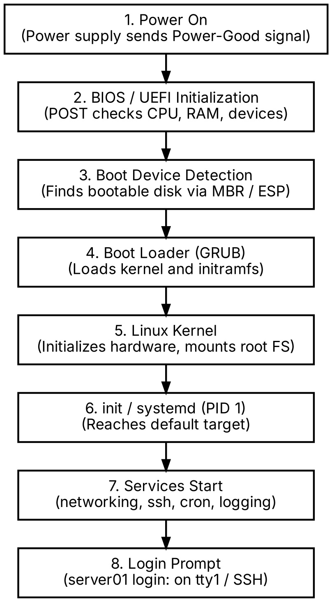

# Week 03: Enterprise Server Deployment and Operating System Installation

**James Oel F. Remillion** | BSIT – 4E
ITEP 414 – System Administration and Maintenance | Techy Techy Solutions

## Project Overview
Techy Techy Solutions is planning to deploy its first Linux server. As the Junior System Administrator, I installed Ubuntu Server 24.04 LTS (No GUI) in a virtual machine, configured the essential settings, verified the installation, compared BIOS and UEFI, and documented every step so that future administrators can reproduce the installation. The server will be used later for file sharing, remote administration, database hosting, web hosting, and internal services.

## Learning Objectives
- Explain the purpose of an operating system in enterprise environments.
- Differentiate BIOS and UEFI firmware.
- Explain the stages of the computer boot process.
- Compare Ubuntu Server, Windows Server, and Rocky Linux.
- Install Ubuntu Server in a virtual machine, and enable SSH for remote administration.
- Verify server functionality, and produce professional documentation.

## Virtual Machine Specifications
| Component | Configuration |
|---|---|
| Name | Ubuntu-Server-Week03 |
| RAM | 4 GB |
| CPU | 2 Virtual Processors |
| Storage | 40 GB (VDI) |
| Network | NAT |
| Optical Drive | Ubuntu Server 24.04 LTS ISO |
| Hypervisor | Oracle VirtualBox **[7.x]** |

## Installation Summary
1. Created the VM in VirtualBox with the specifications above, and skipped the unattended installation.
2. Booted the ISO, and selected **English** as the language.
3. Selected **English (US)** as the keyboard layout.
4. Selected **Ubuntu Server** (not minimized) with no GUI.
5. Accepted **DHCP** on enp0s3.
6. Used **Guided – Use entire disk** with LVM.
7. Created the user **remillion** with hostname **server01**.
8. Installed **OpenSSH Server**.
9. Did not install additional packages, then rebooted and removed the ISO.

## Configuration Summary
| Setting | Value |
|---|---|
| Hostname | server01 |
| User | remillion (sudo) |
| IP Address | **[10.0.2.15/24]** (DHCP) |
| Partition Scheme | GPT with LVM |
| File System | ext4 |
| Disk Size | 40 GB |
| Remote Access | OpenSSH Server, port 22 |

## Verification Results
| Task | Command | Result |
|---|---|---|
| Login | remillion | **[Login successful]** |
| Hostname | `hostname` | **[server01]** |
| IP Address | `ip addr` | **[10.0.2.15/24 on enp0s3]** |
| Internet | `ping -c 4 google.com` | **[4 received, 0% packet loss]** |
| Update | `sudo apt update && sudo apt upgrade -y` | **[Updated successfully]** |
| SSH | `systemctl status ssh` | **[active (running)]** |

Screenshots are in the [screenshots](screenshots/) folder.

## BIOS vs UEFI Highlights
- **Partition Style:** BIOS uses MBR (4 primary partitions), while UEFI uses GPT (128 partitions by default).
- **Disk Support:** BIOS is limited to 2 TB boot disks, while UEFI supports up to around 9.4 ZB.
- **Security:** UEFI supports Secure Boot, and TPM, while BIOS only has a password.
- **Speed:** UEFI runs in 32/64-bit mode, and boots faster than the 16-bit BIOS.
- **Modern Usage:** UEFI is the standard today, and Windows 11 requires it.

Full comparison: [BIOS_vs_UEFI](BIOS_vs_UEFI.pdf)

## Boot Process Flowchart

## Challenges Encountered
- **[Write the actual problem you encountered, and how you solved it]**
- **[Write the actual problem you encountered, and how you solved it]**

## Reflection
This project taught me that installing a server is not about clicking Next until the installation finishes. Before this activity I thought that installing Ubuntu Server was the same as installing Windows on a personal computer. While working on the server for Techy Techy Solutions I realized that every screen in the installer is a decision that affects how the server will work in the future. I learned how to set up a virtual machine, configure the hostname, user account, disk partition and SSH, and how to verify that the server is really working.

For me the challenging part was using Ubuntu Server without a GUI. At first the command line felt harder than a graphical interface, but I realized that it is lighter, faster and easier to manage remotely through SSH. Running commands like hostname, ip addr, ping and systemctl status ssh taught me to check if a server is working instead of just assuming that it is. **[Add one or two sentences about the actual challenge you faced during your installation and how you solved it.]** Researching BIOS and UEFI was also difficult because I had to understand what happens before the operating system even loads, from the firmware, to GRUB, to the Linux kernel and systemd.

Documentation is important because a server is not only used by the person who installed it. If the installation is not documented, the next administrator will have to guess the hostname, the IP address and how the disk was partitioned, which wastes time and can cause mistakes. Comparing Windows Server, Ubuntu Server and Rocky Linux also showed me that there is no single best operating system. The right choice depends on the budget, the services the company needs and the skills of the IT team.

Looking ahead I believe this project will help me become a System Administrator because it trained me to work like one. I now understand that a System Administrator must install, verify and document every system properly so that other people can depend on it. Writing this guide also showed me how important it is to explain technical steps clearly. These are skills I can bring with me to my internship and future work where I will be expected to deploy and maintain servers that the company depends on every day.

## References
- Canonical Ltd. (2024). Ubuntu Server documentation. https://documentation.ubuntu.com/server/
- Canonical Ltd. (2024). Ubuntu 24.04 LTS (Noble Numbat) release notes. https://documentation.ubuntu.com/release-notes/24.04/
- Oracle Corporation. (n.d.). Oracle VirtualBox user manual. https://www.virtualbox.org/manual/
- Microsoft. (n.d.). Windows Server 2022 documentation. https://learn.microsoft.com/en-us/windows-server/
- Rocky Enterprise Software Foundation. (n.d.). Rocky Linux documentation. https://docs.rockylinux.org/
- UEFI Forum. (n.d.). UEFI specifications. https://uefi.org/specifications
- GNU Project. (n.d.). GNU GRUB manual. https://www.gnu.org/software/grub/manual/grub/
- systemd Project. (n.d.). systemd system and service manager. https://systemd.io/
